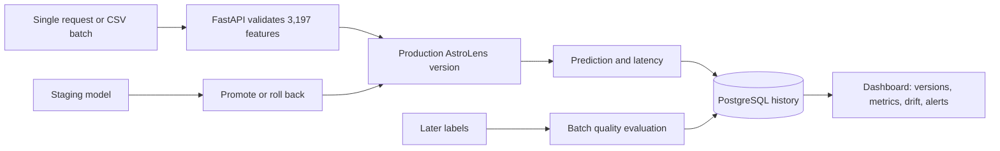

# PulseML

PulseML is a local ML model serving and monitoring platform. It starts with a scikit-learn classifier and can register KeplerVision's actual multi-scale CNN, including its matching scaler, as a new version.

## Start PulseML on Windows

Use Python 3.10–3.13 for both the AstroLens CNN and the scikit-learn models. Open PowerShell in this folder and run these commands one at a time:

```powershell
py -3.10 -m venv "$env:USERPROFILE\pulseml-env"
& "$env:USERPROFILE\pulseml-env\Scripts\Activate.ps1"
python -m pip install --upgrade pip
pip install -r requirements.txt
python -m uvicorn api.main:app --reload
```

If PowerShell says scripts are disabled when activating the environment, run this once in the same PowerShell window, then activate again:

```powershell
Set-ExecutionPolicy -Scope Process -ExecutionPolicy Bypass
& "$env:USERPROFILE\pulseml-env\Scripts\Activate.ps1"
```

Open **http://127.0.0.1:8000** for the dashboard or **http://127.0.0.1:8000/docs** to try the API. Keep the terminal open while using the site. Press **Ctrl+C** there to stop PulseML.

## Run the core checks

From the project root, run the standard-library test suite with the project's Python environment:

```powershell
python -m unittest discover -s tests -v
```

The suite uses temporary databases; it does not change `pulseml.db` or need the CNN model to run.

The first launch creates `pulseml.db` locally and registers AstroLens v1.0.0. Predictions are saved to that SQLite database. The included `models/astrolens.joblib` is KeplerVision's scikit-learn baseline. Python 3.10 is used here because TensorFlow supports it on Windows and the same environment can load both model types. TensorFlow is a large download (about 350 MB), so its first install may take a while.

### CNN artifacts

The CNN and its matching scaler live in the separate KeplerVision project under `models`. To register them, choose `multiscale_cnn.keras` and `multiscale_cnn.scaler.joblib` in PulseML's model form. PulseML validates them and uploads the new version to **staging**; production changes only after you select **Promote**. A fresh PulseML database starts with the scikit-learn v1.0.0 model; uploaded versions are stored in PulseML's local model registry.

## Run with PostgreSQL and Docker

The Docker Compose stack keeps PostgreSQL data in a named volume, keeps uploaded model artifacts in the project's `models` folder, requires an API key, and binds the dashboard/API to this computer only. Install and start Docker Desktop first. Then copy `.env.example` to `.env`, open it, and fill both blank secret values with separate random hex strings:

```powershell
Copy-Item .env.example .env
python -c "import secrets; print(secrets.token_hex(32))"
notepad .env
```

Run the Python command twice. Copy the first printed value to `POSTGRES_PASSWORD` and the second to `PULSEML_API_KEY` in Notepad, then save and close it.

Keep `.env` private. In PowerShell at the project root, start PostgreSQL and wait until it is healthy:

```powershell
docker compose up -d db
```

With PostgreSQL running, merge the existing SQLite model registry, predictions, batches, feedback, and alerts into it. This short-lived container installs the PostgreSQL driver and reads the local database and model files without modifying them. It also rewrites artifact paths to their Docker-mounted locations:

```powershell
docker compose --profile tools run --build --rm migrate
```

Then build and start the dashboard/API:

```powershell
docker compose up --build -d api
```

Open **http://127.0.0.1:8001**. The dashboard will ask for the API key from `.env`. `docker compose down` stops the stack and preserves PostgreSQL data. The service is bound to localhost; it is not configured for public hosting.

## Try a prediction

Use the dashboard's **Run a sample prediction** button, or open `/docs`, expand `POST /api/predict`, and send a JSON body with exactly 3,197 numbers:

```json
{"features": [0, 0, 0]}
```

The short example above illustrates the shape only; an actual request must contain all 3,197 flux values. The dashboard button creates a zero-filled request to demonstrate the API and logging. It is not a scientifically meaningful light curve.

Useful endpoints:

- `GET /api/health` — API and model load status
- `GET /api/models` — registered model versions
- `POST /api/models/register` — upload a trusted `.joblib`, or a `.keras` model plus matching scaler, as a staging version
- `POST /api/models/{model_id}/{version}/promote` — make a registered version production
- `POST /api/models/{model_id}/rollback` — return to the previous production version
- `POST /api/predict` — make and record a prediction
- `POST /api/predict/batch` — upload a CSV with `FLUX.1` through `FLUX.3197`; predicts up to 1,000 rows and records each result
- `POST /api/feedback/batch` — attach KeplerVision `LABEL` values to a prediction batch and calculate accuracy, precision, recall, F1, and confusion counts
- `GET /api/feedback/latest` — retrieve the newest prediction batch and its saved evaluation, if available
- `GET /api/predictions` — recent prediction log
- `GET /api/metrics` — request count, latency, errors, and class counts
- `GET /api/monitoring` — API and prediction distribution signals
- `GET /api/drift` — per-feature PSI against the training reference
- `GET /api/alerts` — open drift alerts
- `POST /api/alerts/{alert_id}/resolve` — resolve an alert

## Project map

- `api/main.py` — API, local database, model loading, prediction logging, basic monitoring
- `web/` — PulseML dashboard (plain HTML, CSS, and JavaScript)
- `models/astrolens.joblib` — trained KeplerVision model artifact
- `data/kepler_reference.npz` — compact feature-distribution profile; raw Kepler training data is not copied here
- `scripts/build_reference_profile.py` — reproducibly build the profile from `exoTrain.csv`
- `scripts/migrate_sqlite_to_postgres.py` — merge the local SQLite history into PostgreSQL without changing SQLite
- `compose.yaml` and `Dockerfile` — localhost-only PostgreSQL and API stack
- `.github/workflows/ci.yml` — SQLite and PostgreSQL tests across Python 3.10 and 3.13
- `requirements-ci.txt` — small test install, without the large TensorFlow package
- `pulseml.db` — created automatically on first run; local records (ignored by Git)
- `LEARNER_GUIDE.md` — the build roadmap in beginner-friendly steps

## Project walkthrough

**PulseML** is an ML serving and reliability project built around AstroLens, a classifier that receives 3,197 Kepler light-curve features. It shows how a trained model can be run as a versioned service and monitored after deployment; PulseML does not train the classifier.



**A short demo:** open the Docker dashboard at **http://127.0.0.1:8001**, enter the API key from `.env` in the browser prompt, show the three AstroLens versions and current production version, run a sample prediction, then show how batch predictions are saved separately from label-based evaluation. Use the database-backed history to explain what survives a container restart.

**Engineering choices to explain:** each prediction records the model version that served it; batch inference ignores labels until a separate evaluation action; PSI drift and reliability alerts are investigation signals rather than claims that a model is wrong; API routes require a key in the Docker stack; PostgreSQL stores model and prediction metadata while uploaded artifacts persist in `models/`.

**Resume bullets (edit to match your contribution):**

- Built PulseML, a FastAPI model-serving and monitoring platform for 3,197-feature AstroLens inputs, with batch inference, a version registry, staged promotion, rollback, and prediction history.
- Added PostgreSQL persistence, Docker Compose, API-key protection, PSI drift and reliability alerts, separate labeled-batch evaluation, and automated SQLite/PostgreSQL tests.

The GitHub Actions workflow runs on pushes and pull requests after this folder is in a GitHub repository. It installs only the dependencies needed by tests; TensorFlow’s real CNN inference is exercised by the Docker runtime, not the lightweight unit-test job.

## Current scope

The verified Docker setup serves AstroLens v1.1.0 from PostgreSQL with three registered model versions and 1,713 migrated predictions. The responsive dashboard has Overview, Model library, Predictions, and Monitoring views, a latency graph, prediction-mix chart, and batch-quality visualization. Nine local behavior tests pass; the CI workflow adds a real PostgreSQL round-trip test across Python 3.10 and 3.13 when run by GitHub Actions.

## Optional API-key authentication

For local development, PulseML stays open while `PULSEML_API_KEY` is unset. To protect API routes, set a random key in PowerShell before starting the server. Never print or commit the key; the dashboard will ask for it when it calls a protected API route. The health endpoint remains public so the dashboard can show whether the server is running.

```powershell
$keyBytes = New-Object byte[] 32
$rng = [Security.Cryptography.RandomNumberGenerator]::Create()
$rng.GetBytes($keyBytes)
$env:PULSEML_API_KEY = [Convert]::ToBase64String($keyBytes)
& "C:\path\to\python.exe" -m uvicorn api.main:app --reload
```

Use the actual Python executable path for your environment. The environment variable lasts only for that PowerShell window; set it again whenever you start a new one.

## Model versions

Select **Register a version** on the dashboard and upload trusted artifacts. A `.joblib` file must accept 3,197 features and provide probabilities for two classes. A KeplerVision `.keras` CNN must be paired with the scaler saved from the same training run. New versions enter **staging**; select **Promote** to serve them. PulseML records the previous production version so **Roll back** can restore it. Joblib files can execute code when loaded, so only use model artifacts you trust.

## Feature drift and alerts

PulseML keeps a compact reference profile made from 4,000 sampled no-planet training rows and all 37 planet rows from KeplerVision's 5,087-row `exoTrain.csv`. It compares the latest **1,000 successful predictions on the currently deployed version** with the reference using PSI for each feature. The dashboard lists the most shifted features; PSI below 0.10 is normal, 0.10–0.25 moderate, and 0.25 or higher high. High drift opens an alert. It is a prompt to investigate, not evidence by itself that the model is wrong. The dashboard's all-zero sample request is only a UI demo and should not be used as a real drift sample.

The profile was generated with a fixed random seed and can be rebuilt if you have the source CSV:

```powershell
python scripts/build_reference_profile.py C:\path\to\exoTrain.csv
```

PulseML also checks the latest 100 inference requests for operational issues. After at least 20 requests for a model version, it opens a high-severity alert when the prediction error rate exceeds 5% or average successful inference latency exceeds 500 ms. Error records currently cover failures during model inference; invalid requests rejected before inference are not counted in this alert rate. Resolve alerts from the dashboard after investigating them.

## Batch predictions from CSV

Use **Predict from a CSV** on the dashboard and select KeplerVision's `exoTest.csv`. It must have columns `FLUX.1` through `FLUX.3197`, numeric finite values, and at most 1,000 rows. Files are limited to 200 MB. Extra columns are ignored; in particular, a `LABEL` column is ignored and is never treated as truth/feedback. Each prediction is saved with the currently deployed version. The CSV upload makes predictions; it does not score accuracy.

To evaluate that batch, copy its displayed batch ID into **Evaluate with labels** and submit the same CSV. PulseML checks that the feature rows and their order match the batch, then separately attaches `LABEL` (1 = no planet, 2 = planet) and reports binary classification metrics with `planet` as the positive class. Its evaluation summary is saved locally and restored after a browser refresh. These metrics describe that labeled dataset, not guaranteed future performance.

The model artifact uses Python pickle through joblib. Only load model files you trust.
